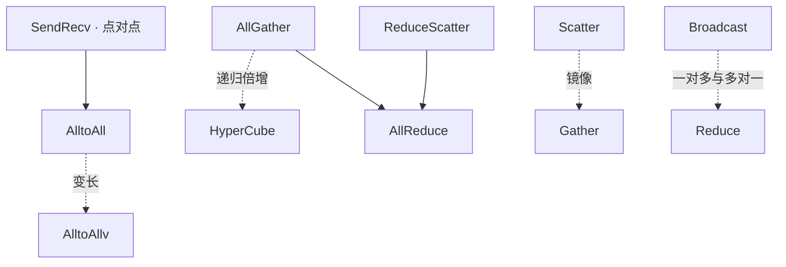

# BW1100 集合通信带宽公式与实测

单机 8 张 BW1100（NMZ）、8 个 rank、FP32。用 **224 GB/s 卡间标称带宽**作为统一参考。2026-11-08 的 DTK 26.10 实测与用户提供的 DTK 26.04 系列截图分别列出。

本页的历史截图和调优数据用于查阅各算子的带宽和参数。按相同参数比较两个 DTK 版本时，参见 [26.04.1 与 26.10 同机 A/B](../DTK_26.04.1_vs_26.10_同机对照.md)。

## 统一公式

- `M` 是 `size` 列的消息大小，本例 1 GiB = 1,073,741,824 B。
- `c` 是 `count` 列的元素个数，FP32 每元素 `s = 4 B`，`n = 8`。
- `t_us` 是测试表中以 µs 为单位的耗时。
- `Q` 是源码计算 algBw 时使用的字节量。`Q × f` 是计算 busBw 的等效字节量。

```text
algBw (GB/s)     = Q / (t_us × 1000)
busBw (GB/s)     = Q × f / (t_us × 1000)
224 参考占比 (%) = busBw / 224 × 100
224 参考耗时 (ms) = Q × f / (224 × 10^6)
```

包长用二进制 GiB/MiB，带宽按十进制 GB/s。归一化系数来自测试程序，链路并发、算法选择与拓扑都体现在实测耗时中。对 224 GB/s 的占比用于统一比较，物理端口利用率需用链路计数器测量。

## 1 GiB 的源码口径

| 算子 | c（元素） | Q | f | Q × f（MiB） | 224 参考耗时（ms） |
| --- | ---: | --- | --- | ---: | ---: |
| [AllGather](AllGather.md) | 33,554,432 | `n × c × s` | `(n−1)/n` | 896 | 4.1943 |
| [AlltoAll](AlltoAll.md) | 33,554,432 | `n × c × s` | `(n−1)/n` | 896 | 4.1943 |
| [AlltoAllv](AlltoAllv.md) | 33,554,432 | `n × c × s` | `(n−1)/n` | 896 | 4.1943 |
| [Broadcast](Broadcast.md) | 268,435,456 | `c × s` | `1` | 1,024 | 4.7935 |
| [Reduce](Reduce.md) | 268,435,456 | `c × s` | `1` | 1,024 | 4.7935 |
| [Scatter](Scatter.md) | 33,554,432 | `n × c × s` | `(n−1)/n` | 896 | 4.1943 |
| [AllReduce](AllReduce.md) | 268,435,456 | `c × s` | `2(n−1)/n` | 1,792 | 8.3886 |
| [Gather](Gather.md) | 33,554,432 | `n × c × s` | `(n−1)/n` | 896 | 4.1943 |
| [ReduceScatter](ReduceScatter.md) | 33,554,432 | `n × c × s` | `(n−1)/n` | 896 | 4.1943 |
| [SendRecv](SendRecv.md) | 268,435,456 | `c × s` | `1` | 1,024 | 4.7935 |
| [HyperCube](HyperCube.md) | 33,554,432 | `(n−1) × c × s` | `1` | 896 | 4.1943 |

## 算子关系



## DTK 26.10 调优复测

单机 8 卡，RCCL 2.27.7-HEAD（`3b793e3`），rccl-tests `40b1b179`。以 1 GiB FP32 out-of-place BusBW 选优，表中带宽和差值均为 GB/s。旧版数值来自 BW1100（NMZ）单机 8 卡 1G 截图，截图未注明测试模式、数据类型和命令。差值为 26.10 三轮中位数减去 26.04.1-rc1 的历史数值。

旧版有记录的 10 项算子均在三轮中超过旧版数值，其中 8 项通过完整扫包。点击算子名称可查看对应的复测命令。

| 算子与复测命令 | 26.04-rc4 | 26.04.1-rc1 | 26.10 调优中位数 | 26.10 调优最低 | 对上一版差值 | 验收范围 |
| --- | ---: | ---: | ---: | ---: | ---: | --- |
| [AllGather](AllGather.md#dtk-2610-复测命令) | 129.37 | 129.46 | 130.18 | 130.16 | +0.72 | 完整扫包 |
| [AlltoAll](AlltoAll.md#dtk-2610-复测命令) | 117.82 | 118.31 | 120.60 | 120.55 | +2.29 | 完整扫包 |
| [AlltoAllv](AlltoAllv.md#dtk-2610-复测命令) | 93.26 | 93.47 | 97.51 | 97.28 | +4.04 | 完整扫包 |
| [Broadcast](Broadcast.md#dtk-2610-复测命令) | 131.47 | 131.50 | 131.61 | 131.57 | +0.11 | 完整扫包 |
| [Reduce](Reduce.md#dtk-2610-复测命令) | 131.29 | 131.33 | 131.39 | 131.37 | +0.06 | 1 GiB out-of-place |
| [Scatter](Scatter.md#dtk-2610-复测命令) | 162.23 | 162.23 | 163.77 | 163.74 | +1.54 | 完整扫包 |
| [AllReduce](AllReduce.md#dtk-2610-复测命令) | 131.18 | 131.22 | 131.48 | 131.46 | +0.26 | 1 GiB out-of-place |
| [Gather](Gather.md#dtk-2610-复测命令) | 163.94 | 163.94 | 164.27 | 164.17 | +0.33 | 完整扫包 |
| [ReduceScatter](ReduceScatter.md#dtk-2610-复测命令) | 127.68 | 127.80 | 128.59 | 128.59 | +0.79 | 完整扫包 |
| [SendRecv](SendRecv.md#dtk-2610-复测命令) | 128.68 | 128.78 | 130.48 | 130.43 | +1.70 | 完整扫包 |
| [HyperCube](HyperCube.md#dtk-2610-复测命令) | — | — | 113.94 | 113.87 | — | 完整扫包 |

- **完整扫包**覆盖 1 MiB 到 1 GiB 的 11 档包长，检查该用例支持校验的模式。带宽对照取 1 GiB。
- **1 GiB out-of-place** 每轮执行三次正确性检查。Reduce 和 AllReduce 的完整扫包分别在 64/128 MiB 和 256 MiB 出现过校验错误，表中这两项采纳单点结果。
- AlltoAll 的 1 GiB in-place 三轮中位数为 **125.13 GB/s**。AlltoAll、AlltoAllv 和 SendRecv 的 in-place 均为 `#wrong=N/A`，仅计时。
- HyperCube 使用 8 线程每线程 1 卡，旧版截图缺少该算子，调优筛选未测得稳定提升。

逐轮 1 GiB 数据保存在仓库旁的 `rccl-private/doc/bw1100/collectives/`。 [安装与运行说明](../DTK_26.10_BW1100_RCCL_安装与测试.md)
